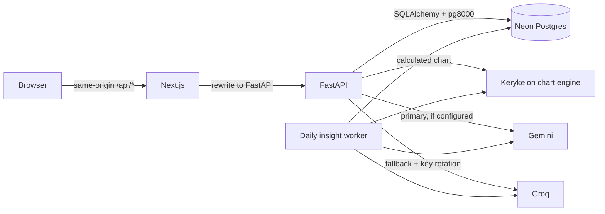

# Melooha

**A Vedic astrology Q&A take-home that keeps answers tied to calculated chart facts.**

[Open the live app](https://melooha-task.vercel.app/) · [](https://github.com/MetkarAdi/meloohaTask/actions/workflows/tests.yml)

## The idea

After the one free question, a zero-balance user has nothing free to come back to.
Melooha adds a free, plain-language **My Chart** page that works at zero balance.
Answers follow the user's language and are checked in code against calculated chart facts; **See chart facts** is one tap away.
The product metric is **D7 return**.

## What it does

### Core experience

- Vedic chart Q&A with a question balance and an **Add questions** demo flow.
- Saves a question as a draft when the balance is zero, so it can be answered after credits are added.
- Streams checked answer sections and keeps question history.
- Calculates chart facts in code; the answer model receives the question and selected facts, not profile identity.
- Tries Gemini first, then Groq with configured key rotation; provider errors are replaced with a friendly message.
- My Chart and its fact sheet remain available without a question credit.

### Claimed extras

- English/Hindi interface, with replies prompted to follow the language of the question.
- Paired provider evaluation harness with deterministic chart checks and independent model judges.

### Also built (not claimed as extras)

- Speech to text using Groq Whisper, with Gemini fallback.
- Read aloud using the browser's `speechSynthesis` API.
- A daily insight job and an on-demand daily insight endpoint.
- Chart image sharing; birth details are excluded unless the user opts in.

## Quick start

### Prerequisites

- Node.js 22 (the CI workflow uses 22).
- Python 3.11 or newer (CI uses Python 3.12).
- A Neon PostgreSQL database and at least one configured Gemini or Groq API key to generate answers.

### Run locally

```bash
git clone https://github.com/MetkarAdi/meloohaTask.git
cd meloohaTask
```

Copy `.env.example` to `.env.local`, then fill in the values you need. In PowerShell:

```powershell
Copy-Item .env.example .env.local
```

Start the app:

```bash
npm run dev
```

`npm run dev` runs setup when dependencies or the virtual environment are missing, applies Alembic migrations, then starts Next.js, FastAPI, and the daily insight worker. The web app is at `http://localhost:3000`; the API is at `http://127.0.0.1:8000`.

**`DATABASE_URL` is required for app data.** Set it to a Neon Postgres URL. The app has no SQLite runtime fallback; SQLite is used for isolated tests only. `DATABASE_URL_UNPOOLED` is used for Alembic migrations. Login also requires a private `JWT_SECRET` of at least 32 characters.

### Environment variables

All names below are from `.env.example`. “Required” means required for the named capability; provider keys are optional individually, but at least one is needed for generated answers.

| Variable | Required? | Where it comes from / use |
| --- | --- | --- |
| `DATABASE_URL` | Yes, for app data | Neon pooled Postgres connection string. |
| `DATABASE_URL_UNPOOLED` | Yes, for migrations | Neon direct (unpooled) Postgres connection string. |
| `JWT_SECRET` | Yes, for login | Generate a private random value of 32+ characters. |
| `ADMIN_SECRET` | Yes, for admin endpoints | Set a private random secret; send it in the `ADMIN_SECRET` header. |
| `GEMINI_API_KEY` | Optional provider | Google AI Studio; Gemini is tried first when configured. |
| `GEMINI_MODEL` | Optional | Gemini model name; default is `gemini-3.5-flash-lite`. |
| `GROQ_API_KEY` | Optional provider | Groq Console; used as fallback when Gemini fails or is absent. |
| `GROQ_API_KEY_2`–`GROQ_API_KEY_4` | Optional | Additional Groq keys for rotation when a configured key fails. |
| `GROQ_MODEL` | Optional | Groq model name; default is `openai/gpt-oss-20b`. |
| `GROQ_TIMEOUT_SECONDS` | Optional | Groq request timeout; example default is 20 seconds. |
| `GEMINI_TIMEOUT_SECONDS` | Optional | Gemini request timeout; example default is 20 seconds. |
| `GEMINI_MAX_TRANSIENT_RETRIES` | Optional | Maximum Gemini transient retry count; example default is 1. |
| `LLM_RETRY_BASE_DELAY_SECONDS` | Optional | Shared retry backoff base; example default is 0.25 seconds. |
| `GROQ_INPUT_PRICE_PER_MILLION` | Optional | Only for custom Groq model pricing not listed in code. |
| `GROQ_OUTPUT_PRICE_PER_MILLION` | Optional | Only for custom Groq model pricing not listed in code. |
| `APP_ENV` | Optional | Set `development` locally; controls production-only behavior. |
| `COOKIE_SECURE` | Optional | Set `false` locally; production cookies are secure when `APP_ENV=production`. |
| `NEXT_PUBLIC_API_URL` | Optional locally | FastAPI base URL for the Next.js `/api` rewrite; local default is `http://localhost:8000`. |
| `API_HOST` | Optional locally | API bind host; local default is `127.0.0.1`. |
| `API_PORT` | Optional locally | API bind port; local default is `8000`. |

Keep provider keys and database credentials on the server. Do not use `NEXT_PUBLIC_` for secrets.

## Architecture



The Next.js rewrite in `web/next.config.ts` sends browser requests under `/api` to `NEXT_PUBLIC_API_URL`. FastAPI calculates the chart and routes only relevant facts to the answer pipeline. The worker polls the database-backed daily insight jobs.

### One `/ask` request

1. Create or update the question record and reserve one wallet credit. If the balance is zero, keep it as a draft and return it to the user.
2. Calculate the chart with the Vedic chart engine and deterministically select chart (`F###`) and meaning (`M###`) facts for the question.
3. Give the question and selected facts to Gemini first, then Groq if Gemini is unavailable or fails validation. Groq can rotate through configured keys.
4. Apply hard answer checks. A rejected answer gets one correction generation from that provider; if it still fails, move on to the next provider.
5. Stream completed, checked sections with SSE events: `response_start`, `message_start`, `message_delta`, `message_complete`, and `response_complete`. A provider switch can emit `response_error` with `restart: true`; final failure emits `response_error`.
6. On success, persist the answer and selected facts. If every provider fails, persist a localized unavailable message, mark the question failed, and refund the reserved credit.

### Stored data

| Table | Stores |
| --- | --- |
| `users` | Login accounts. |
| `birth_profiles` | Birth details and calculated chart data/facts. |
| `wallets` | Current question-credit balance. |
| `questions` | User questions, drafts, answers, facts, ratings, and provider usage. |
| `wallet_ledger` | Credit changes and refunds. |
| `events` | Signup, sessions, and product events. |
| `jobs` | Daily insight job status and retries. |
| `daily_insights` | Generated daily insight and its facts. |

### Trade-offs

- **pg8000 instead of psycopg:** the SQLAlchemy Postgres URL is normalized to `postgresql+pg8000`; this keeps the declared driver set in `api/requirements.txt`.
- **Hard checks vs. soft citation style:** unsupported chart claims and unsupported IDs reject an answer; citing every sentence is not required.
- **Model-selected reply language:** the prompt asks for the question's language, and a conservative code check catches Hindi, Spanish, Turkish, or French mismatches. This is not a general multilingual guarantee.
- **Same-origin cookies:** the browser calls `/api` through the Next.js rewrite and uses same-origin credentials, keeping auth cookie requests on the app origin.
- **Free tiers:** the project is designed around free-tier services, which can sleep, impose limits, or change availability. No uptime or provider quota is guaranteed by the code.

## How answer grounding works

- `F###` IDs identify calculated chart facts. `M###` IDs identify approved interpretation text stored in `api/app/llm/interpretations.json`.
- The model is instructed to use only supplied facts and meanings. The API does not send the user's name, email, or profile metadata as model context.
- Hard validation rejects unknown citations or meaning tooltips, unsupported planets/signs/houses, unsupported planet placements or signs, unsupported dates, unsupported ascendant signs, certainty language, invalid/duplicate fact IDs, and detected language mismatches.
- Citation coverage is optional: the model need not cite every sentence. The current validator does not populate soft citation warnings, so there is no active warning-only coverage score.
- An unused `safe_fact_answer()` helper can compose an answer from facts, but the request path does not call it. Total provider failure currently returns a localized unavailable message and refunds the credit.

## Language support

- The interface toggle offers **English** and **Hindi**.
- The answer prompt asks the model to reply in the language of the question, including section headings. Planet, sign, and house names should also remain in English in brackets beside translated terms so the checker can recognize them.
- The code mismatch guard detects Hindi, Spanish, Turkish, and French when it has enough script or word evidence. Detection and replies in other languages are best-effort, not verified guarantees.

## Tests, evaluation, and CI

Run from the repository root:

```bash
npm test
npm run eval:smoke
npm run eval
```

`npm test` runs deterministic Node and Python checks; backend tests use `TEST_DATABASE_URL` or a temporary SQLite database. `npm run eval:smoke` runs six live cases; `npm run eval` runs the full paired evaluation. The evaluator compares Gemini and Groq answers, uses the other provider as judge, validates judge JSON for relevance, clarity, completeness, consistency, grounding, and certainty avoidance, and reports accuracy, grounding, interpretation scores, latency, token use, estimated cost, failure examples, and change from the prior report.

Fixtures use synthetic birth data and a pinned `2026-11-15T12:00:00Z` evaluation instant. The app recalculates expected snapshots using its Lahiri/whole-sign chart engine; snapshot drift requires review. Cases cover D1 basics and placements, house rulers, D9/D10, Vimshottari periods, a coded Budha-Aditya condition, and questions the chart cannot answer. If Gemini's daily quota is exhausted while judging Groq, the evaluator tries `gemma-4-26b-a4b-it`.

The GitHub Actions workflow uses Node 22 and Python 3.12, then runs `npm run setup` and `npm test`. It runs the live smoke evaluation only when both `GROQ_API_KEY` and `GEMINI_API_KEY` GitHub secrets are present; otherwise it skips it. CI does not run lint or typecheck.

The live evaluation uses these thresholds in CI:

| Variable | CI value | Meaning |
| --- | ---: | --- |
| `EVAL_MIN_FACTUAL_ACCURACY` | `0.70` | Minimum deterministic factual accuracy. |
| `EVAL_MIN_GROUNDING_RATE` | `0.90` | Minimum grounding rate. |
| `EVAL_MIN_INTERPRETATION_QUALITY` | `3.4` | Minimum average judge interpretation score. |
| `EVAL_STRICT_SUBJECTIVE` | `0` | Subjective judge thresholds are advisory unless enabled. |

The runner also accepts provider and threshold options; see `api/evals/__main__.py` and `api/evals/runner.py`. Reports are written to `docs/eval-report.md` and `.json` (the Markdown file is not present yet).

### Latest evaluation results

<!-- TODO(aditya): Run npm run eval and add the latest measured results from docs/eval-report.md. -->

## Product metric: D7 return

`GET /admin/metrics` (also reachable as `/api/admin/metrics` through the web rewrite) requires the `ADMIN_SECRET` request header. There is no admin metrics page in the UI.

`day_7_return_rate` is the share of users with a recorded signup event at least seven days old who also have a `session_start` event on the calendar date exactly seven days after signup. The denominator includes all eligible signed-up users, not only zero-balance users. `api/scripts/seed_demo.py` creates synthetic demo accounts and event timelines; those records are illustrative, not real usage.

## Deployment

The code is structured for a Vercel Next.js frontend, a Render FastAPI service, and Neon Postgres. Vercel's build-time `NEXT_PUBLIC_API_URL` configures the `/api` rewrite; FastAPI expects Postgres URLs, and its lifespan runs migrations when a database URL is configured.

<!-- TODO(aditya): Confirm Vercel project root/build settings, Render build/start/health settings, environment-variable values, and production cookie/domain behavior before publishing deployment instructions. -->
